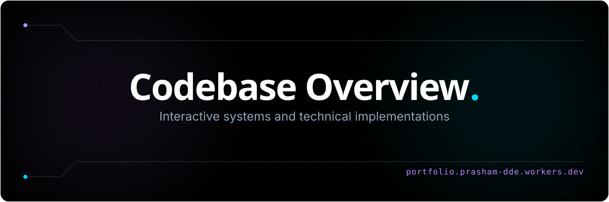
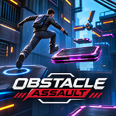
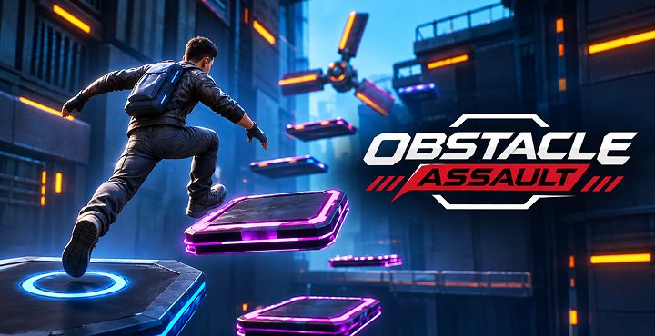
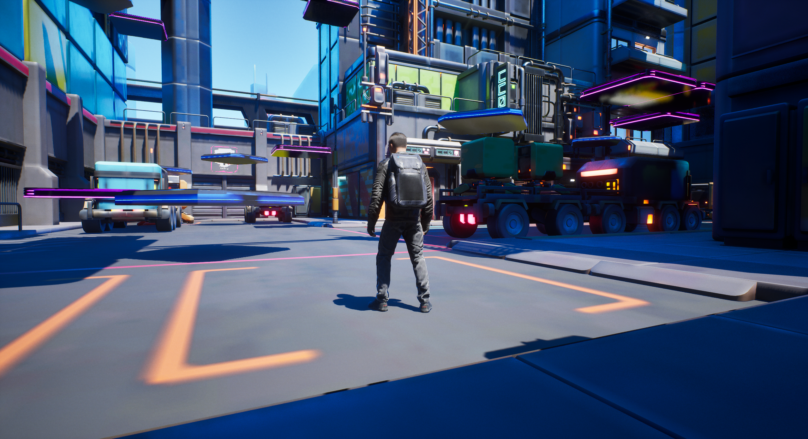
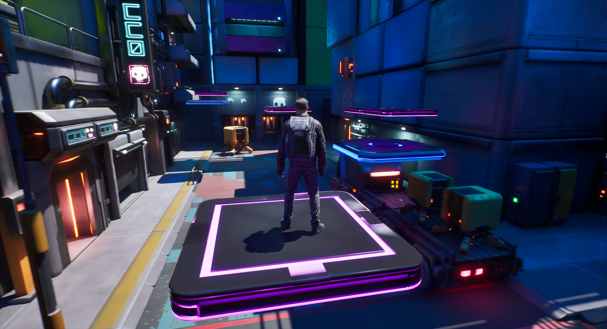
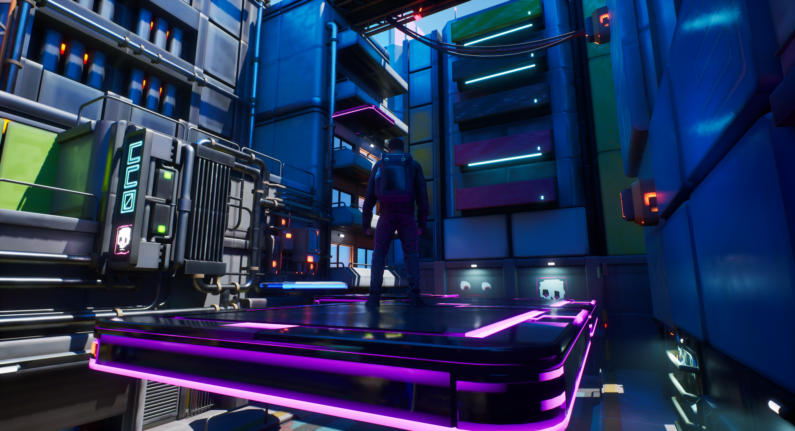
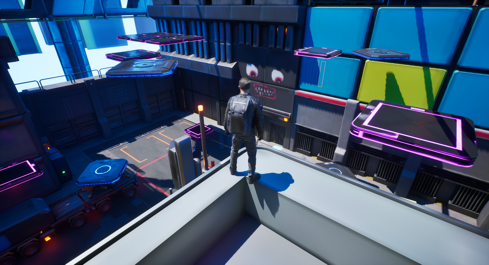
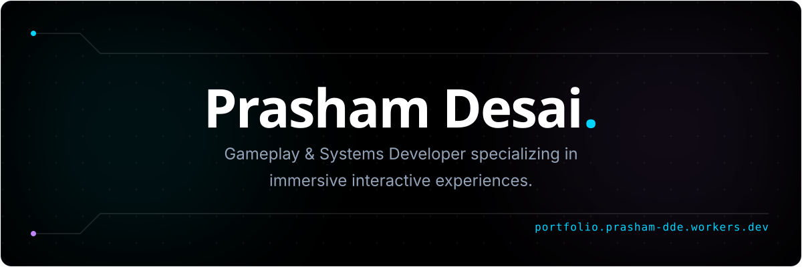

<div align="center">
  
</div>

<div align="center">

# 🏃 Obstacle Assault



### *A 3D Third-Person Platformer & Obstacle Challenge in Unreal Engine 5*

[](https://www.unrealengine.com/)
[](https://github.com/)
[](https://github.com/)
[](https://github.com/)

---



</div>

## 📖 About the Game

**Obstacle Assault** is a 3D third-person obstacle platformer developed in **Unreal Engine 5.6**. Players navigate through an intricate sci-fi obstacle facility featuring dynamic moving platforms, rotating hazards, tight gaps, and height challenges. 

The core mechanics emphasize precision timing and jump execution, driven by performant, custom **C++ platform movement and rotation logic** with complete designer flexibility exposed to Blueprints.

---

## ✨ Core Features

### ⚙️ Custom C++ Moving Platform Mechanics (`AMovingPlatform`)
- **Linear Translation (`MovePlatform`)**:
  - Moves platforms smoothly along a vector path at configurable `PlatformVelocity` scaled by frame `DeltaTime`.
  - Computes travel progress using vector dot-product distance calculation:
    ```cpp
    float DistanceBeyondTarget = FVector::DotProduct((CurrentLocation - TargetLocation), MoveDirection);
    ```
  - Eliminates floating-point overshoot and position drift by clamping precisely to target coordinates before ping-pong inversion.
- **Continuous Local Rotation (`RotatePlatform`)**:
  - Adds real-time rotational movement via `FRotator PlatformRotationRate`, creating spinning hazard surfaces and timed landing pads.
- **Ping-Pong Trajectory & Inversion (`InvertPlatformDirection`)**:
  - Automatic direction switching between `StartLocation` and `EndLocation` based on configurable `MoveDistance`.
- **Editor-Exposed Variables**:
  - Full designer control via `UPROPERTY(EditAnywhere, BlueprintReadWrite)` for instantaneous tweaking of speed, direction, rotation rate, and travel distance without recompilation.

### 🏃 Third-Person Character & Movement
- Built on Unreal Engine 5's third-person template and Enhanced Input System.
- Responsive running, directional acceleration, jumping, air control, and orbit camera navigation.

### 🚀 Modular Sci-Fi Obstacle Course
- Multi-tiered platforming challenge assembled with sci-fi modular architecture, ramps, ledges, and hazard zones.
- Level progression designed to test player reflexes and spatial awareness.

---

## 📸 Screenshots

<div align="center">
<table>
<tr>
<td width="50%"></td>
<td width="50%"></td>
</tr>
<tr>
<td width="50%"></td>
<td width="50%"></td>
</tr>
</table>
</div>

---

## 🎮 Controls (Default)

| Action | Primary Key (Keyboard & Mouse) | Gamepad |
| :--- | :--- | :--- |
| **Move Forward / Backward** | <kbd>W</kbd> / <kbd>S</kbd> | Left Stick (Y-Axis) |
| **Move Left / Right** | <kbd>A</kbd> / <kbd>D</kbd> | Left Stick (X-Axis) |
| **Look / Camera Orbit** | <kbd>Mouse</kbd> | Right Stick |
| **Jump** | <kbd>Space</kbd> | Face Button Down (<kbd>A</kbd> / <kbd>✕</kbd>) |
| **Pause / Menu** | <kbd>Esc</kbd> | Special Right / Menu |

---

## 🛠️ Built With

- **Engine:** [Unreal Engine 5.6](https://www.unrealengine.com/)
- **Programming Language:** C++ (Core movement & platform mechanics)
- **Scripting & Editor Tooling:** Unreal Blueprints Visual Scripting
- **Input Framework:** Enhanced Input System

---

## 📦 Required Fab Marketplace Assets

> [!IMPORTANT]
> To keep the repository lightweight and adhere to distribution guidelines, large 3D environment and character asset packs are **excluded from Git tracking (`.gitignore`)**. 
>
> If you are setting up or cloning this project, you need to add these asset packs from **[Fab](https://www.fab.com/)** (Epic Games Marketplace) into your `Content/` folder:

| Folder Path | Asset Description | Source |
| :--- | :--- | :--- |
| `Content/LowerSector_Mod/` | Modular Sci-Fi environment structures, walls, catwalks, and materials | Fab Marketplace |
| `Content/SciFi_Props/` | Sci-Fi industrial props, crates, canisters, and decorative meshes | Fab Marketplace |
| `Content/Survival_Character/` | Sci-Fi survival character model, skeleton, and animation set | Fab Marketplace |

### How to Install the Fab Assets:
1. Open the **Epic Games Launcher** or go to **[Fab.com](https://www.fab.com/)**.
2. Locate or acquire the respective asset packs in your Fab library:
   - **Lower Sector Modular**
   - **SciFi Props**
   - **Survival Character**
3. Click **"Add To Project"** and select **ObstacleAssault**.
4. Confirm that the folders appear under the project's `Content/` directory matching the paths shown above.

---

## 🚀 Getting Started

### Prerequisites
- **Unreal Engine 5.6** (or compatible UE5 release) installed via Epic Games Launcher.
- **Visual Studio 2022** (with *Desktop development with C++* and *Game development with C++* workloads).

### How to Build & Run
1. Clone the repository:
   ```bash
   git clone https://github.com/Prasham-Desai/ObstacleAssault.git
   cd ObstacleAssault
   ```
2. Download and place the required asset packs into `Content/` as described in the [Required Fab Marketplace Assets](#-required-fab-marketplace-assets) section.
3. Right-click **`ObstacleAssault.uproject`** and select **Generate Visual Studio project files**.
4. Open **`ObstacleAssault.sln`** in Visual Studio 2022, set the build configuration to **Development Editor** / **Win64**, and press **F5** (or Build Solution).
5. In Unreal Editor, navigate to the Content Browser and open:
   ```text
   Content/Levels/Lvl_ObstacleAssault.umap
   ```
6. Click the **Play (PIE)** button in the editor toolbar to jump into the obstacle course!

---

## 📂 Project Structure

```text
ObstacleAssault/
├── Config/                      # Engine, input, and project settings (.ini)
├── Content/
│   ├── Blueprints/              # Blueprint classes (BP_MovingPlatform, BP_RotatingPlatform)
│   ├── Characters/              # Mannequins, skeletons, and animation assets
│   ├── Levels/                  # Level maps (Lvl_ObstacleAssault, Lvl_TestLevel)
│   ├── LowerSector_Mod/         # [Fab Asset] Modular sci-fi environment (gitignored)
│   ├── SciFi_Props/             # [Fab Asset] Sci-fi prop models & materials (gitignored)
│   └── Survival_Character/      # [Fab Asset] Character mesh & animations (gitignored)
├── Images/                      # Project banners, logos, and icons
│   ├── Banner.png               # Game splash banner
│   ├── github-intro-banner.svg  # Intro overview banner
│   ├── github-readme-banner.svg # Creator signature footer banner
│   ├── Logo.png                 # Game logo
│   └── Icon.png                 # Game icon
├── Screenshots/                 # 2x2 gameplay showcase screenshots
│   ├── SS1.png
│   ├── SS2.png
│   ├── SS3.png
│   └── SS4.png
├── Source/
│   └── ObstacleAssault/         # C++ gameplay logic
│       ├── MovingPlatform.h     # AMovingPlatform class declaration
│       ├── MovingPlatform.cpp   # Vector math, overshoot checks & rotation logic
│       ├── ObstacleAssaultCharacter.h/cpp # Character movement logic
│       └── ObstacleAssaultGameMode.h/cpp  # GameMode configuration
├── ObstacleAssault.uproject     # Unreal Engine 5 project descriptor
├── .gitignore                   # Unreal Engine 5 & Fab asset ignore configuration
└── README.md                    # Project documentation
```

---

<div align="center">
  
</div>
